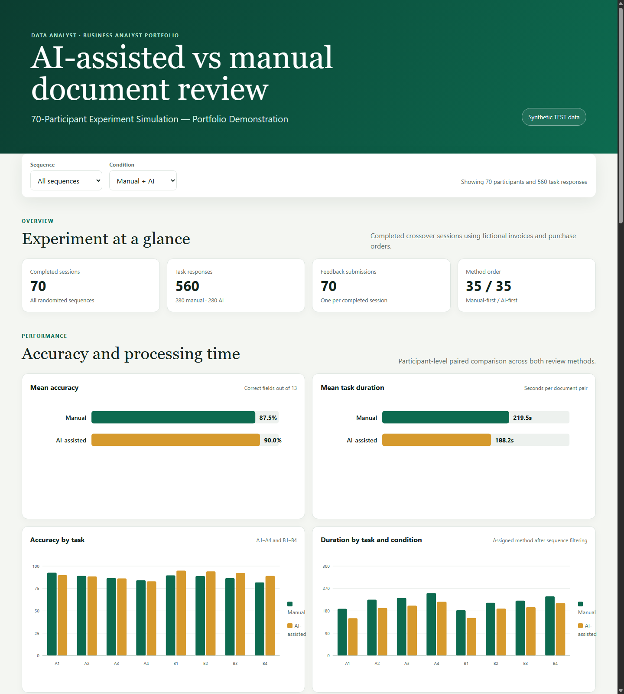
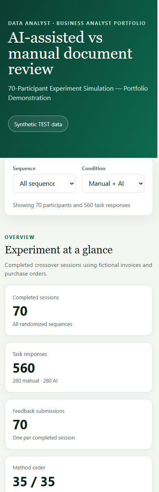

# AI-assisted vs manual business-document processing

> **70-Participant Experiment Simulation — Portfolio Demonstration**
>
> Every participant session, task response, timestamp, profile, and feedback record in this repository is fictional simulation data. No recruited people or real company records are represented. The results demonstrate an analytics workflow and are not evidence of real-world AI effectiveness.



## Project overview

This Data Analyst / Business Analyst portfolio project examines a controlled question: **in a matched business-document review workflow, how do AI-assisted and manual methods compare on accuracy, processing time, confidence, and workload?**

The repository contains a reproducible analysis of simulation batch `SIM70-20261113-A` and a responsive interactive dashboard that runs entirely in the browser. It has no Supabase connection, backend, environment variables, credentials, or deployment secrets.

[Open the dashboard](https://amer1997000.github.io/ai-business-research-dashboard/) · [Analysis summary](analysis/SUMMARY.md) · [Methodology](docs/METHODOLOGY.md) · [Data dictionary](analysis/DATA_DICTIONARY.md)

## Business problem

Operations teams process invoices and purchase orders under time pressure, but faster extraction is only valuable when discrepancies remain detectable. A useful decision framework must therefore balance speed, accuracy, user effort, and implementation risk.

## Experiment represented by the simulation

The simulated design is a randomized two-period crossover:

- each session completes four manual and four AI-assisted tasks;
- matched document sets A and B contain fictional invoices and purchase orders;
- sequences S1–S4 balance method order and document-set allocation;
- identical documents are not repeated within a session;
- 35 sessions are manual-first and 35 are AI-first.

The batch contains 70 complete simulated sessions, 560 task responses, and 70 feedback submissions.

## Public dataset

| File | Grain | Rows | Contents |
|---|---|---:|---|
| `participants.csv` | One simulated session | 70 | anonymous synthetic code, allocation, fictional schedule and synthetic profile |
| `tasks.csv` | One task response | 560 | method, task, duration and scored accuracy |
| `feedback.csv` | One questionnaire | 70 | confidence, workload, preference and quality flags |

Database UUIDs and internal submission identifiers were removed before publication. Participant codes are random synthetic identifiers. The simulated dates from 28 September to 8 November 2026 are scheduling metadata—not actual participation dates.

## Analysis methods

The Node analysis script constructs participant-level condition means, task and sequence summaries, activity distributions, and individual paired differences. For accuracy, duration, confidence, and workload, it reports the paired mean difference, two-sided 95% t interval, paired t statistic, and Cohen's *dz*.

These statistical outputs describe the simulation generator only. They cannot support population estimates or causal claims about AI.

## Descriptive results

| Metric | Manual | AI-assisted | Paired difference (AI − manual) |
|---|---:|---:|---:|
| Accuracy | 87.5% | 90.0% | +2.5 percentage points |
| Mean task duration | 219.5 s | 188.2 s | −31.3 s |
| Confidence (1–5) | 4.46 | 4.33 | −0.13 |
| Workload (1–5) | 4.07 | 3.53 | −0.54 |

Preferences were AI-assisted for 36 simulated sessions, manual for 14, and no preference for 20.

## Interactive dashboard

The dashboard provides:

- overview KPIs and allocation counts;
- manual versus AI accuracy and processing time;
- task-level accuracy and duration;
- confidence, workload, and preference comparisons;
- sequence distribution and sequence-level results;
- fictional date, weekday/weekend, and time-band activity;
- participant-level paired differences;
- condition and sequence filters, accessible labels, legends, and tooltips;
- responsive desktop and mobile layouts.



## Run locally

No Power BI, database, package installation, or API key is required.

```powershell
node analysis/serve.js
```

Open `http://127.0.0.1:4173/dashboard/`. The file `dashboard/index.html` can also be opened directly.

## Reproduce the analysis

```powershell
node analysis/analyze.js
```

This regenerates `analysis/summary.json`, `analysis/SUMMARY.md`, and the embedded static dashboard bundle from the three public CSV files.

## Repository structure

```text
dashboard/   Static dashboard and anonymized simulated CSV files
analysis/    Reproducible analysis scripts, outputs, and data dictionary
docs/        Methodology and dashboard guide
screenshots/ Desktop and mobile dashboard previews
.github/     GitHub Pages deployment workflow
```

## Limitations

- No observation represents a recruited human participant.
- All behavior, timings, questionnaire responses, and preferences are generated.
- Confidence intervals reflect simulated values and cannot validate AI effectiveness.
- Fictional schedule data cannot support claims about recruitment or participation patterns.
- A real study requires prospective power assessment and finalized consent, privacy, retention, withdrawal, and applicable ethics review.

## Skills demonstrated

Experimental design · business process analysis · data validation · paired statistical analysis · JavaScript data pipelines · responsive dashboard design · accessible data visualization · GitHub Actions · GitHub Pages · security-conscious public data preparation
